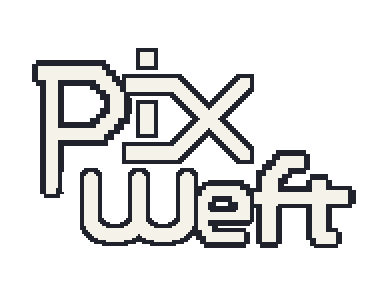
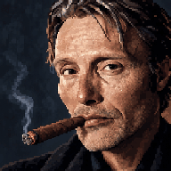
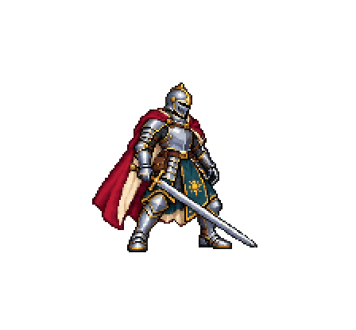
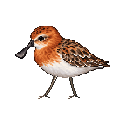
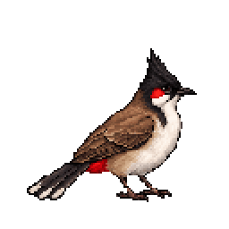
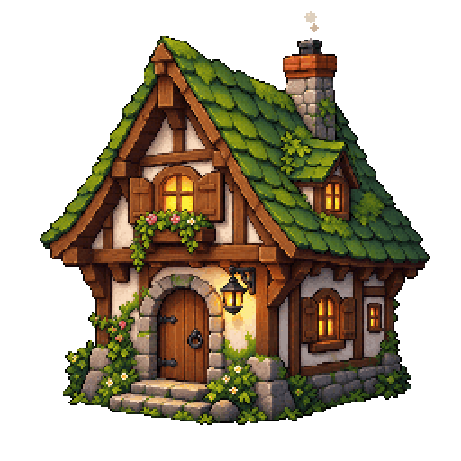
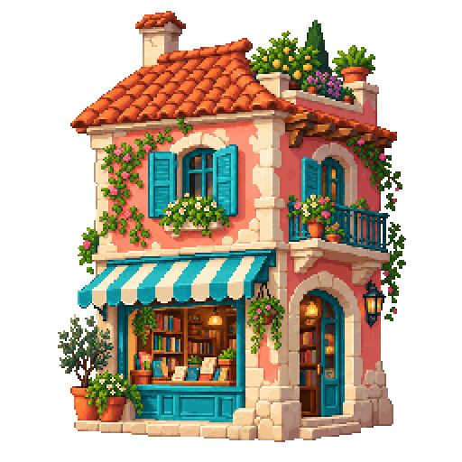

<p align="center">
  
</p>

<h1 align="center">PixWeft: Pixel game developer for Codex</h1>

<p align="center">
  <a href="README.md">English</a> &middot; <a href="README.zh-CN.md">简体中文</a>
</p>

<p align="center">PixWeft 是面向 Codex 的像素游戏开发插件，结合 Godot 与 Pixelorama，从创意和 AI 辅助美术，到玩法、试玩与迭代。</p>

<p align="center">目前为 <strong>0.1.0 源码预览版</strong>，提供可组合的 Skill 与本地软件操作工具。</p>

## 效果展示

<table>
  <tr>
    <td align="center" valign="middle" width="480">
      <p align="center">
        &emsp;&ensp;
      </p>
    </td>
    <td valign="middle">
      <h3>像素肖像动画</h3>
      <p>抽雪茄的男人，九帧像素肖像动画。</p>
      <p><em>9 帧 &middot; 1.8 秒循环</em></p>
    </td>
  </tr>
  <tr>
    <td align="center" valign="middle" width="480">
      <p align="center">
        
      </p>
    </td>
    <td valign="middle">
      <h3>中世纪骑士 &middot; 挥剑</h3>
      <p>从蓄力、挥剑到收势，展示人物动作的完整过程。</p>
      <p><em>人物动作动画</em></p>
    </td>
  </tr>
  <tr>
    <td align="center" valign="middle" width="480">
      <p align="center">
        
      </p>
    </td>
    <td valign="middle">
      <h3>现代社畜 &middot; 待机</h3>
      <p>拿着咖啡的疲倦上班族，通过呼吸与眨眼呈现待机状态。</p>
      <p><em>人物待机动画</em></p>
    </td>
  </tr>
  <tr>
    <td align="center" valign="middle" width="480">
      <p align="center">
        
      </p>
    </td>
    <td valign="middle">
      <h3>勺嘴鹬 &middot; 行走</h3>
      <p>通过双腿交替落地，呈现轮廓清楚的鸟类行走循环。</p>
      <p><em>小动物动画</em></p>
    </td>
  </tr>
  <tr>
    <td align="center" valign="middle" width="480">
      <p align="center">
        
      </p>
    </td>
    <td valign="middle">
      <h3>红耳鹎 &middot; 跳跃</h3>
      <p>将蓄力、跳起与落地衔接为一段小鸟跳跃循环。</p>
      <p><em>小动物动画</em></p>
    </td>
  </tr>
  <tr>
    <td align="center" valign="middle" width="480">
      <p align="center">
        
      </p>
    </td>
    <td valign="middle">
      <h3>林间小屋</h3>
      <p>用烟囱冒烟与窗灯轻微变化，为保留细节的小屋添加环境动画。</p>
      <p><em>建筑环境动画</em></p>
    </td>
  </tr>
  <tr>
    <td align="center" valign="middle" width="480">
      <p align="center">
        
      </p>
    </td>
    <td valign="middle">
      <h3>地中海书店</h3>
      <p>通过灯光与植物的局部轻动，为书店增添生气并保留建筑结构。</p>
      <p><em>建筑环境动画</em></p>
    </td>
  </tr>
</table>

通过 PixWeft 尝试不同的美术风格。[展示目录](examples/showcase/README.md) 提供可编辑源文件、精灵图、prompt 和制作记录。

游戏的风格、视角、画布、调色板和地图组织方式由你决定。PixWeft 支持 TileMap、自由摆放场景、分层背景、可复用模块和混合搭建。

## 使用版本

| 组件 | 开发使用版本 |
| --- | --- |
| Godot | **4.6.3 stable，Windows x86_64** |
| Pixelorama | **1.1.10-stable，Extensions API 8** |
| Node.js | **22 或更新版本** |

原生集成在 Windows 上开发和测试。Pixelorama 自带 Godot 4.6.2 运行时，与游戏使用的引擎独立。

## 独立能力与总入口

从 `$pixweft` 开始，也可以直接调用某个独立能力：

| Skill | 用途 |
| --- | --- |
| `pixweft` | 规划下一步，协调各个能力 |
| `game-design` | 讨论创意、范围、机制和可玩原型 |
| `pixel-art` | 准备生图 prompt、导入美术、制作动画，并按需编辑像素 |
| `godot-scenes` | 搭建地图、摆放物件，设置碰撞、导航和深度 |
| `godot-gameplay` | 实现输入、规则、交互和玩法状态 |
| `game-ui` | 制作界面、视觉状态、交互和自适应布局 |
| `game-review` | 检查美术、试玩、定位问题和复查修订 |
| `game-build` | 准备导出、检查构建、打包可玩版本 |

新游戏可以走完整流程，小任务可以只用一个能力。具体示例见 [工作流](docs/workflows.md)。技能、prompt、代码和技术文档使用英文，README 提供中英文版本。

## 安装到 Codex

在插件目录执行：

```powershell
npm ci --ignore-scripts
codex plugin marketplace add .
codex plugin add pixweft@pixweft-local
```

开启新对话，使用 `$pixweft` 或某个独立能力。如果 Codex 另建了插件副本，也在该副本中执行 `npm ci --ignore-scripts`。使用时保留完整的 `skills/`、`shared/` 和相关文件。

## 配置游戏工作区

为游戏目录创建配置：

```powershell
node scripts/cli.mjs project_init --project /absolute/path/to/game
```

游戏设定记录在 `.pixel-game/project.json`。本机应用路径和连接配置放在被忽略的 `.pixel-game/project.local.json`：

```json
{
  "tools": {
    "godot_path": "/absolute/path/to/godot-console-executable",
    "pixelorama_path": "/absolute/path/to/Pixelorama.exe",
    "pixelorama_url": "http://127.0.0.1:32124",
    "pixelorama_token": "YOUR_LOCAL_RANDOM_SECRET"
  }
}
```

也可通过 `GODOT_PATH`、`PIXELORAMA_PATH`、`PIXEL_GAME_PIXELORAMA_URL`、`PIXEL_GAME_PIXELORAMA_TOKEN` 配置。使用 `PIXEL_GAME_PROJECT_ROOT` 为 MCP 选择游戏目录。

检查工具连接：

```powershell
node scripts/cli.mjs doctor --project /absolute/path/to/game
```

为兼容已有项目，继续沿用 `.pixel-game/` 和 `PIXEL_GAME_` 命名。

## 美术工作流

生图前，PixWeft 会主动询问是否有风格参考图。已有参考图或已经回答过时直接沿用，也可以根据文字需求继续制作。

- **静态美术：生成图片 → 直接导入 Pixelorama。**
- **动画：生成多帧参考精灵图 → 将各帧导入 Pixelorama。**

角色、建筑、道具、瓦片、UI、头像等图片都采用这个流程。默认保留导入的生成像素，可以检查并指出问题；需要微调时，再按你的要求编辑。

图片由 Codex 当前可用的生图工具或配置的服务生成。`image_prompt` 负责准备 prompt，包括参考图用途、画布、比例、透明背景、锚点和动画布局。源文件与导出保持对应，便于后续在 Pixelorama 和 Godot 中继续制作。

## Godot 与 Pixelorama 工具

**Godot：** 创建和检查场景、修改属性、检查资源、调整工程设置，以及运行输入、状态观察和截图序列。操作在独立引擎进程中执行，详见 [Godot 桥接](bridges/godot/README.md)。

**Pixelorama：** 导入导出精灵图、保存和重开可编辑的 `.pxo` 文件、预览 PNG，以及操作像素、图层、帧、帧率和调色板。按 [Pixelorama 配置说明](docs/pixelorama.md) 构建并启用本地扩展，设置密钥和允许访问的游戏目录。

构建扩展包：

```powershell
npm run build:pixelorama -- --godot <executable>
```

MCP 入口：`project_init`、`project_inspect`、`toolchain_doctor`、`image_prompt`、`godot_operation`、`godot_runtime`、`pixelorama_operation` 和 `run_status`。

CLI 使用相同入口，例如：

```powershell
node scripts/cli.mjs godot_operation --project /absolute/path/to/game --args request.json
```

其中 `request.json`：

```json
{"operation":"scene_inspect","args":{"scene_path":"res://main.tscn"}}
```

游戏构建由 `game-build` 使用 Godot 标准导出命令完成。各项操作的参数见对应桥接文档。

## 开发与检查

```powershell
npm run validate
npm test
```

检查覆盖包结构、MCP 通信、项目隔离、资产测量和原生应用流程。配置本机应用路径后可启用原生测试，见 [验证说明](docs/validation.md) 和 [集成示例](examples/neutral-lab/README.md)。

## 致谢

能力拆分和“探讨—制作—审阅”的流程参考了 [Academic Research Skills](https://github.com/Imbad0202/academic-research-skills)。详见 [来源与依赖](THIRD_PARTY.md)。原创插件代码采用 [MIT 许可](LICENSE)。
