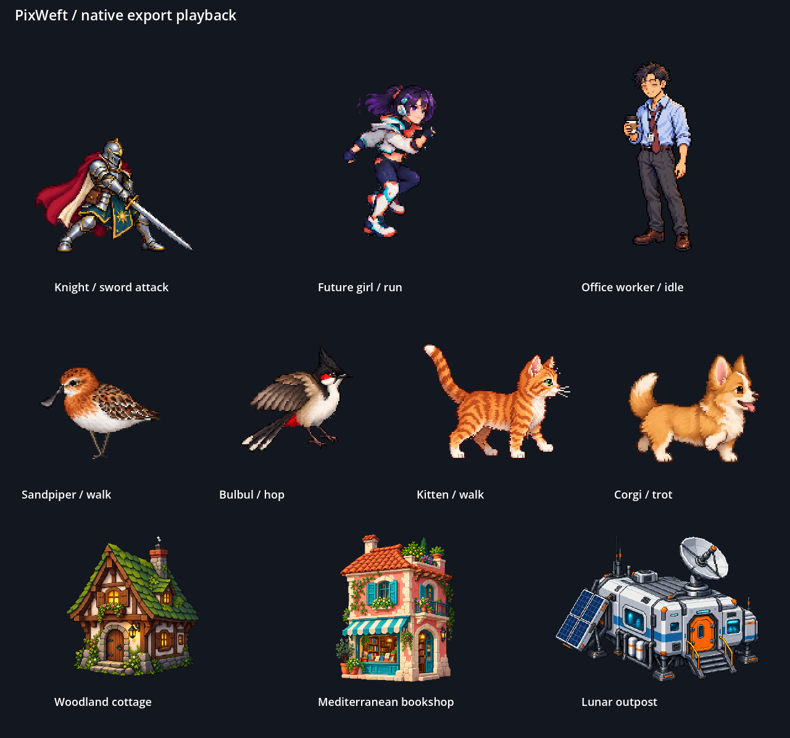

# PixWeft showcase

This directory documents the README demonstrations. These subjects, styles,
canvas sizes, timings, palettes, views, and motions are example choices, not
defaults inherited by another game.

## How the artwork was made

For new images, the current [image workflow](../../shared/references/image-production.md)
asks once for style reference images, then generates artwork and directly imports
it into Pixelorama. Animation starts with a multi-frame reference sprite sheet.
Imported pixels are preserved by default; adjustments are made when requested.

The notes below record the actual selected inputs and production methods of
the existing examples.

- **Characters:** a designed medieval knight attacks with a sword; a future
  girl runs; a tired office worker idles. Codex's built-in image tool supplies
  design and pose drafts. Pixelorama handles the actual logical canvas, alpha
  cleanup, corrections, frame arrangement, editable sources, and PNG exports.
  Generated bases remain raster layers; source files do not pretend to have
  independently editable anatomy that was never separated.
- **Animals:** four new designs start from generated references, followed by
  reviewed design/motion candidates and native Pixelorama animation and
  refinement. Per-asset records distinguish selected pixels from rejected studies.
  The examples use
  one readable action per loop: a sandpiper walks, a bulbul hops and lands, a
  kitten walks, and a puppy trots. Body identity, limb ownership, support and
  contact phases, and the loop boundary need visual review as well as file checks.
- **Buildings:** the three selected generated buildings are imported and refined
  in Pixelorama, preserving their architecture and material detail. Their raster
  bases stay fixed while separate layers animate smoke, windows, foliage, and
  the outpost's radar dish. The radar scans +/-4 degrees around a fixed mount
  over two seconds, with the complete mast and collar held still and native
  pixel retouching of the moving socket in every pose. Rigid rotation of a
  cropped part is only a draft; it does not establish a continuous joint.
  These replace the rejected simplified redraws. A few poses
  deliberately hold; eight source frames do not imply eight unique poses.

No numeric artistic palette cap is imposed. Hard pixel edges and intentional
clusters still matter. GIF previews are encoded by **FFmpeg from real
Pixelorama-exported PNG frames**, at integer 2x nearest-neighbor magnification.
They are not recordings of cursor activity. GIF encoding has a format palette
and centisecond timing; PNG and PXO retain their authored RGB values.

## Files

- [Runtime PNG sheets and GIFs](../../assets/showcase/).
- [Character sources and production records](sources/characters/).
- [Animal references, editable sources, and motion review](sources/animals/README.md).
- [Building sources and production records](sources/buildings/).
- [Building reference prompts](building-prompts.md).
- Native per-building refinement scripts are beside their sources in
  [the building directory](sources/buildings/).
- [Godot playback verifier](preview.mjs).

Rejected candidates, private working drafts, application copies, machine paths,
bridge tokens, full operation logs, and runtime caches stay in ignored `.local/`.
Selected design references and generation drafts are included beside sources
where useful for provenance. Sources and manifests describe actual creation methods. Replacing an
asset invalidates its old hashes and dependent runtime evidence.

## Reproduce the refinements

Run from the repository root after installing the Node dependencies. Supply
your own executables; no application location is bundled.

```powershell
node examples/showcase/sources/buildings/lunar-outpost-refinement.mjs --godot $GodotPath --pixelorama-dir $PixeloramaDirectory --ffmpeg $FfmpegPath
node examples/showcase/preview.mjs --godot $GodotPath
```

The outpost example explicitly replaces its own example outputs. It uses a
fresh private Pixelorama application profile and does not use the installed
application's preferences or open documents. The preview creates a
private Godot project under `.local/`, imports the actual sheets, and uses the
plugin's **stdio MCP** for measurements and rendered playback captures. A frame
coverage result proves that the engine displayed the frames, not that their
motion is aesthetically good; visual inspection remains a separate check.

## Verification

[Source fidelity](sources/source-verification.json) records a fresh Pixelorama
process opening each of the ten final PXO files and reproducing the published
PNG sheet exactly. [The asset index](manifest.json) records the current files,
sizes, timing, creation routes, and hashes. [Validation](validation.json) covers
the executed tool and playback checks. [Focused motion review](motion-review.json)
records the reported defects, inspected frames, actual observations, and scope
of the six repaired examples separately from automatic measurements.

The following is an actual rendered Godot capture of the final exports:


